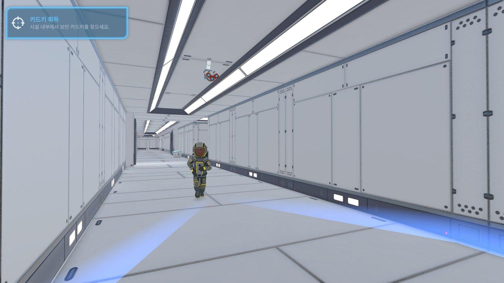

# Silent Access

> Guard의 감시를 피해 시설에 침투하고, 서버 데이터를 탈취한 뒤 탈출하는 **3D FPS 잠입 게임**입니다.

[▶ 플레이 영상](https://youtu.be/JWgPkPTI8nQ) · [GitHub Repository](https://github.com/Leo-Reu/SilentAccess)

## 프로젝트 개요

| 항목 | 내용 |
| --- | --- |
| 개발 형태 | 개인 프로젝트 (1인) |
| 개발 기간 | 2026.09.30 ~ 2026.11.16 (약 7주) |
| 플랫폼 | Windows PC |
| 엔진 / 언어 | Unity 6.3 LTS (6000.3.17f1), C# |
| 렌더 파이프라인 | URP |
| 주요 기술 | Input System, NavMesh, FSM, ScriptableObject, Custom Editor, Occlusion Culling |

카드키 획득 → 보안실 터미널 조작 → 서버실 접근 → 데이터 탈취 → 시설 탈출로 이어지는 미션을 구현했습니다. Guard에게 포착되면 실패하며, 데이터 탈취 이후의 실패는 서버실 체크포인트에서 재시도할 수 있도록 구성했습니다.

## 핵심 구현

### 1. Guard FSM과 감지 시스템

Guard의 개별 행동을 `Patrol`, `Investigate`, `Suspicious`, `Chase`, `Search` 상태로 분리했습니다. 시각 감지는 거리·시야각·장애물 Raycast를 조합하고, 발소리와 CCTV 감지 이벤트도 조사 행동으로 연계합니다.

- 상태별 이동·대기·조사 행동을 분리해 전환 조건을 관리
- Chase 중 시야를 잃으면 마지막 목격 지점을 바탕으로 Search 수행
- 수색·조사 도중 새 발소리가 발생하면 목표 위치를 갱신하도록 개선
- CCTV 표시 범위를 장애물에 맞게 시각화하고, 실제 감지 판정과 구분해 관리

**관련 코드:** [GuardController.cs](https://github.com/Leo-Reu/SilentAccess/blob/develop/Assets/01.Scripts/AI/Guard/GuardController.cs) · [StateMachine.cs](https://github.com/Leo-Reu/SilentAccess/blob/develop/Assets/01.Scripts/AI/Guard/StateMachine.cs) · [GuardVision.cs](https://github.com/Leo-Reu/SilentAccess/blob/develop/Assets/01.Scripts/AI/Perception/GuardVision.cs)

### 2. Adaptive Security Director

개별 Guard의 FSM과 시설 전체의 보안 정책을 분리하기 위해 **Adaptive Security Director**를 구현했습니다. 발소리·CCTV 감지·추격 이벤트를 Security Pressure로 반영하고, 보안 단계에 따라 Guard의 행동 파라미터와 지원 수색 정책을 조정합니다.

- **Normal / Caution / HighAlert** 단계별 순찰 대기, 조사·수색 시간 및 이동 속도 배율 적용
- 플레이어의 정확한 현재 위치 대신 마지막 목격 위치와 지원 사건을 중심으로 정보를 전달
- 지원 Guard 선정 시 단순 직선거리 대신 **NavMesh 경로 비용**을 계산
- 길목 차단 위치의 NavMesh 유효성 및 기존 순찰 경로와의 간섭을 고려

**관련 코드:** [AdaptiveSecurityDirector.cs](https://github.com/Leo-Reu/SilentAccess/blob/develop/Assets/01.Scripts/AI/Director/AdaptiveSecurityDirector.cs)

### 3. 협력 수색 사건의 생명주기 관리

수색 중인 Guard와 지원 Guard의 역할을 구분하고, 지원 사건의 생성·할당·종료를 관리했습니다. 수색 종료 후에도 지원 Guard가 이전 목표로 이동하던 문제를 재현한 뒤, 종료 보고 및 지원 취소 흐름을 정리했습니다.

- `HashSet`을 활용한 수색·지원 요청 Guard 관리
- `Dictionary`를 활용한 지원 Guard별 작업 상태 추적
- 수색 종료 여부, 유예 시간, 지원 작업 타임아웃을 종합한 사건 종료 처리
- 종료 후 지원 Guard의 순찰 복귀 확인

**관련 코드:** [AdaptiveSecurityDirector.cs](https://github.com/Leo-Reu/SilentAccess/blob/develop/Assets/01.Scripts/AI/Director/AdaptiveSecurityDirector.cs) · [GuardController.cs](https://github.com/Leo-Reu/SilentAccess/blob/develop/Assets/01.Scripts/AI/Guard/GuardController.cs)

### 4. 미션과 개발 편의 기능

- `MissionController`를 중심으로 미션 단계, 보안 경보, 성공·실패 및 재시도 흐름 관리
- Guard Patrol Route를 Scene View에서 편집하는 **Custom Editor** 구현 (Shift + 좌클릭으로 Waypoint 추가, NavMesh 유효성 표시)
- 메인 메뉴, 일시정지, 게임 방법, 입력 설정 및 BGM/SFX를 포함한 게임 UI 구성

**관련 코드:** [MissionController.cs](https://github.com/Leo-Reu/SilentAccess/blob/develop/Assets/01.Scripts/Mission/MissionController.cs)

## 렌더링 최적화 및 검증

Occlusion Culling을 적용하고 Windows 빌드에서 **OFF / ON 별도 빌드**의 FPS를 네 구역에서 수동 비교했습니다.

| 측정 구역 | OFF | ON |
| --- | ---: | ---: |
| 로비 | 600 FPS | 700 FPS |
| 카드키 방 | 745 FPS | 800 FPS |
| 보안실 | 626 FPS | 791 FPS |
| 서버실 | 551 FPS | 768 FPS |
| **4구역 관측값의 산술평균** | **630.5 FPS** | **764.8 FPS** |

- **관측 평균 FPS 증가:** 약 21.3%
- **측정 환경:** Intel Core i7-13700K / RTX 4070 Ti / RAM 32GB / 2560×1440 전체화면 / FPS 제한 해제
- **측정 방법:** NVIDIA HUD 및 작업 관리자, 구역별 단일 관측
- **한계:** 동일 구역의 반복 측정·프레임타임 통계 없이 관측한 값으로, 일반적인 성능 향상률을 보장하는 벤치마크는 아닙니다.

## 조작 방법

| 조작 | 키 |
| --- | --- |
| 이동 / 시점 | WASD / 마우스 |
| 달리기 / 앉기 | Left Shift / Left Ctrl |
| 상호작용 | E (고정) |
| 투척 아이템 사용 | 마우스 왼쪽 버튼 |

일부 키는 게임 내 설정에서 변경할 수 있으며, 상호작용 키 `E`는 고정입니다.

## 실행 및 확인

1. [플레이 영상](https://youtu.be/JWgPkPTI8nQ)에서 미션 진행과 AI 동작을 확인할 수 있습니다.
2. Unity 프로젝트를 열려면 **Unity 6.3 LTS (6000.3.17f1)** 버전을 사용하세요.
3. 이 저장소에서 외부 유료 에셋 파일이 제외되어 있다면, 코드만으로 동일한 장면을 완전히 재현할 수 없습니다. 필요한 외부 리소스는 아래 출처를 참고하세요.

## 외부 리소스 및 크레딧

시각·음향 리소스는 직접 제작한 코드와 구별하여 사용했습니다. 아래 항목은 **프로젝트에서 활용한 외부 리소스**이며, 각 제작자의 권리는 해당 라이선스에 따릅니다.

| 용도 | 리소스 |
| --- | --- |
| 시설 환경 | [3D Scifi Kit Vol 3](https://assetstore.unity.com/packages/3d/environments/sci-fi/3d-scifi-kit-vol-3-121447) |
| Guard 모델·애니메이션 | [Astronauts - Modular Animated Pack](https://assetstore.unity.com/packages/3d/characters/humanoids/sci-fi/astronauts-modular-animated-pack-363890) |
| 시설 내부 소품 | [Sci-Fi Props - Low Poly 3D Models Pack](https://assetstore.unity.com/packages/3d/props/sci-fi-props-low-poly-3d-models-pack-331660) |
| 메뉴·HUD 등 | [Shift - Complete Sci-Fi UI](https://assetstore.unity.com/packages/2d/gui/shift-complete-sci-fi-ui-157943) |
| 발소리 | [Footsteps - Pack](https://assetstore.unity.com/packages/audio/sound-fx/foley/footsteps-pack-330509) |
| 시설·경보 효과음 | [Sci-Fi Sounds](https://marketplace.unity.com/packages/audio/sound-fx/sci-fi-sounds-22391) |
| UI 효과음 | [Modern UI SFX - sound pack](https://assetstore.unity.com/packages/audio/sound-fx/modern-ui-sfx-sound-pack-198858) |

**BGM 출처 및 저작자 표기**

- **Main Menu:** [Exploration Theme](https://opengameart.org/content/exploration-theme) — Cleyton Kauffman, CC0
- **Stealth:** [Pondering the Cosmos](https://opengameart.org/content/pondering-the-cosmos) — Ruskerdax, CC0
- **Escape:** [Electric Inferno (Code Injection, Track 06)](https://davidkbd.itch.io/code-injection-dark-techno-music-pack) — DavidKBD, [CC BY 4.0](https://creativecommons.org/licenses/by/4.0/)

외부 에셋 및 음악의 재배포 여부는 각각의 라이선스에 따릅니다. 게임의 기능과 시스템을 구현한 C# 코드의 작성 범위와 외부 그래픽·사운드 제작물을 혼동하지 않도록 구분했습니다.
